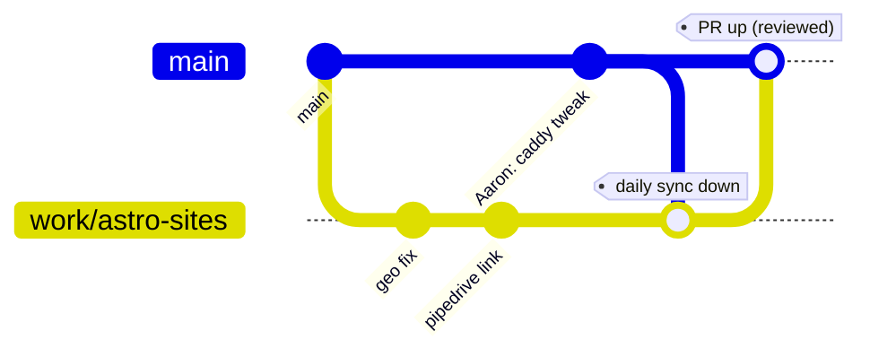

# Two-developer Git workflow — Connect Group Astro fleet

**Goal:** Prabhjas works on `work/astro-sites`, Aaron works on `main`, and neither steps on the other or breaks a deploy.

**Repo:** `Connect-Group-Tech/Astro-websites` · SSH host alias `github-connectgroup`
**Branches that matter:** `main` (source of truth, always deployable) · `work/astro-sites` (Prabhjas dev) · `work/live-fleet-34` (frozen 34-site cutover — never rewrite unless asked)

---

## 1. The model in one line

> **`main` is the trunk. Aaron owns it. Everything Prabhjas builds flows into `main` through a Pull Request. `main` flows back down into `work/astro-sites` every day.**



- **Down (main → work/astro-sites):** frequent, low-cost, keeps Prabhjas current with Aaron's direct commits. Use **merge** (never rebase a pushed shared branch).
- **Up (work/astro-sites → main):** through a **PR**, so Aaron sees the change before it can ship.

---

## 2. Who owns what (avoid editing the same file at once)

| Area | Owner | Notes |
|------|-------|-------|
| `Astro-production/<site>/**` app code, content, `src/`, `public/` | **Prabhjas** | Feature/site work |
| `docs/**`, root `package.json`, `pnpm-lock.yaml` | **Prabhjas** (announce lockfile changes) | One lockfile — see §5 |
| `caddy/**`, `deploy/**`, `*.service`, host/root scripts, immutable release | **Aaron** | Owner-only; never edit live `/etc/caddy` or systemd from a dev laptop |
| CI (`.github/workflows/**`) | **Aaron** (Prabhjas via PR) | |

If you must touch the other person's area, **say so first** and do it in its own small PR.

---

## 3. Golden rules

1. **Never `git push --force` (or `-f`) to `main` or `work/astro-sites`.** History on shared branches is append-only.
2. **`main` is always deployable.** Don't merge a half-finished change into it.
3. **One `pnpm-lock.yaml`.** Only one person changes it at a time (§5). `pnpm` only — no `npm install`.
4. **Sync down daily** before you start, so conflicts stay small.
5. **Commit as the repo author, repo-local only** — never change global git config:
   ```bash
   git -c user.name="prabhjass-afk" -c user.email="prabhjass-afk@users.noreply.github.com" commit -m "message"
   ```
6. **Never commit secrets / `.env` / `.env.prod` / `node_modules` / `dist/`.**
7. **Deploy is Aaron's, and separate from `main`.** A merge to `main` is *code ready*; a live release is a distinct step Aaron runs (new immutable release + Caddy). Merging does **not** ship.

---

## 4. Prabhjas — daily loop

```bash
# 0. Start of day: pull Aaron's latest main into your branch
git checkout work/astro-sites
git fetch origin
git merge origin/main            # absorb Aaron's direct-to-main commits
#   -> if lockfile changed:  pnpm install
#   -> resolve any conflicts, build the touched site to confirm green
git push origin work/astro-sites

# 1. Do work, commit in small logical chunks
git add -A
git -c user.name="prabhjass-afk" -c user.email="prabhjass-afk@users.noreply.github.com" \
    commit -m "geo: CF Cf-Ipcountry + AE fallback across fleet"
git push origin work/astro-sites

# 2. When a unit of work is ready to ship -> open a PR into main
#    (GitHub UI, or:)
gh pr create --base main --head work/astro-sites \
   --title "Fleet: CF geo + nanoid + Pipedrive link" \
   --body "What changed, how verified, what Aaron must do to release."
```

**Tip (optional, cleaner):** for a big or risky change, branch off `main` for just that task —
`git checkout -b feat/cf-geo origin/main` — PR it, delete it after merge. Keeps `work/astro-sites` from growing into one giant divergent branch. `work/astro-sites` stays your default for day-to-day.

---

## 5. Aaron — working on `main`

```bash
git checkout main
git pull --ff-only origin main   # always start current
# small owner/host/config change...
git add -A && git commit -m "caddy: memory bump note for CR"
git push origin main
```

- Keep direct-to-`main` commits **small and self-contained** (config, host notes, hotfixes). Anything large or app-facing is easier as a branch + PR too, but direct is fine for owner changes.
- **Review Prabhjas's PRs** (or at least skim + merge). Prefer **"Merge"** or **"Squash and merge"**; avoid "Rebase and merge" on this repo so shared history isn't rewritten.
- After merging a PR, tell Prabhjas so he syncs down.

---

## 6. The lockfile & shared-file protocol (the #1 conflict source)

- Before changing `pnpm-lock.yaml` / root `package.json`, **sync down first** (`git merge origin/main`), then change, then push promptly. Don't sit on a lockfile change for days.
- If two lockfiles diverge and conflict: **don't hand-merge the lockfile.** Take one side, then re-resolve:
  ```bash
  git checkout origin/main -- pnpm-lock.yaml   # or your side
  pnpm install                                 # regenerate deterministically
  git add pnpm-lock.yaml && git commit
  ```
- Catalog/override pins live in root `package.json` + `pnpm-workspace.yaml` — change those **once**, then `pnpm install`.

---

## 7. Recommended one-time GitHub setup (safety rails)

On `main` branch protection (Settings → Branches):
- ☑ **Block force pushes** and **block deletions** (both devs).
- ☑ Require a PR before merging **from anyone except the owner** — or leave direct push on for Aaron and rely on discipline. (Minimum viable: just the force-push/deletion block.)
- Optional: add a `CODEOWNERS` so `caddy/`, `deploy/` auto-request Aaron on any PR touching them.

Same **block force-push + deletion** on `work/astro-sites` and `work/live-fleet-34`.

---

## 8. Cheat sheet

| I want to… | Do this |
|------------|---------|
| Get Aaron's latest into my branch | `git fetch origin && git merge origin/main` |
| Ship my work | push `work/astro-sites`, open PR into `main` |
| Aaron ship a small fix | commit direct to `main`, push |
| Undo my local mess (not pushed) | `git restore .` / `git reset --hard @{u}` |
| See what differs from main | `git fetch && git log --oneline origin/main..work/astro-sites` |
| Never do | `git push -f` to a shared branch; edit live Caddy/systemd; commit secrets |

---

## Right now (this session's state)

`work/astro-sites` has a large **uncommitted** change set (CF geo across 34, nanoid bump, Pipedrive link on 3 sites, docs). To land it cleanly:

1. `git fetch origin && git merge origin/main` (absorb anything Aaron pushed).
2. Commit in a few logical chunks (geo / nanoid / pipedrive / docs) as the repo author.
3. Push `work/astro-sites`, open **one PR into `main`** describing the change + "owner must build a new immutable release to go live."
4. Aaron reviews/merges, then runs the release.
