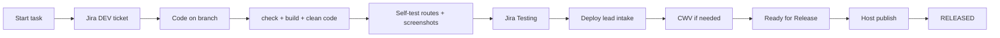

# Developer Fleet Handbook — Jira, Quality, Testing & Handoff

**Mushtaq, Tabish, Rajpal:** features, content, fixes → **Testing**.  
**Prabhjas (deploy lead):** intake, CWV optimization, publish → **RELEASED**.

Cursor loads `.cursor/rules/developer-fleet-handbook.mdc`.

**Related docs:**

| Doc | Use for |
|-----|---------|
| [DEVELOPER-SESSION-PROMPT.md](DEVELOPER-SESSION-PROMPT.md) | Paste at start of Cursor session |
| [TASK-PASTE.md](TASK-PASTE.md) | Each task (`---TASK---`) |
| [DEVELOPER-CLEAN-CODE.md](DEVELOPER-CLEAN-CODE.md) | **Required** — CWV-safe habits + dirty-code rules |
| [JIRA-DEV-WORKFLOW.md](JIRA-DEV-WORKFLOW.md) | Jira MCP setup, dual tickets, transition IDs |
| [DEVELOPER-CWV-CHECKLIST.md](DEVELOPER-CWV-CHECKLIST.md) | Part A blockers (devs); full checklist (deploy lead) |
| [CWV-WAVE-PROMPT.md](CWV-WAVE-PROMPT.md) | **Deploy lead only** — Lighthouse 95+ |
| [DEVELOPER-HANDOFF.md](../DEVELOPER-HANDOFF.md) | Host publish path (deploy lead only) |
| [FLEET-PORT-REGISTRY.md](../FLEET-PORT-REGISTRY.md) | Local preview ports (5080–5124) |

---

## How this handbook fits together



**Developers stop at F.** Deploy lead owns G → K (including CWV at H).

---

## Phase 0 — One-time setup

### 0.1 Atlassian MCP in Cursor

Follow [JIRA-DEV-WORKFLOW.md §1](JIRA-DEV-WORKFLOW.md#1-connect-atlassian-mcp-in-cursor-one-time). Each developer signs in with their Connect Group Atlassian account.

### 0.2 Session prompt + task paste

1. Paste **[DEVELOPER-SESSION-PROMPT.md](DEVELOPER-SESSION-PROMPT.md)** once per Cursor session.
2. Paste **`---TASK---`** from **[TASK-PASTE.md](TASK-PASTE.md)** for each task.

Repo rule automates Jira + testing. **Do not** paste name or account ID. Say **`done`** when finished.

### 0.3 Know your local port

```bash
node scripts/fleet-local.mjs list
```

Example: `connecthr` → `http://127.0.0.1:5084/`

---

## Phase 1 — Start work → paste task (Jira automatic)

**Rule:** Paste `---TASK---` from [TASK-PASTE.md](TASK-PASTE.md). Cursor creates the Jira ticket via Atlassian MCP — detects **you**, port, package, brand field. Do not create Jira manually.

### What Cursor does automatically

When you paste a task block, the agent:

1. **`atlassianUserInfo`** → assignee (no manual name/ID)
2. **`scripts/fleet-sites.json`** → site-id, port, package name
3. **`scripts/jira-commit-sync.mjs`** → Brand field id
4. **Search DEV** for duplicate → create if none
5. **In Progress (31)** + ticket key in reply

When you say **`done`**: developer testing gate (check/build, fleet-local, routes, diff audit) → Jira comment → screenshots check → **Testing (51)**. **No Lighthouse 95+ for developers.**

### Ticket granularity

| Work | Tickets |
|------|---------|
| Same brand, one feature wave | **1** ticket |
| Multiple brands in one push | **1 ticket per brand** |
| Docs-only / lockfile noise | **Skip** — no ticket |
| Fleet publish batch | **Deploy ticket** on Prabhjas + dev tickets per brand |

### Dual tickets (unchanged)

- **Dev ticket** (Mushtaq / Tabish / Rajpal) → through **Testing**
- **Deploy ticket** (Prabhjas) → **Ready for Release → RELEASED**

See [JIRA-DEV-WORKFLOW.md § Dual tickets](JIRA-DEV-WORKFLOW.md#dual-tickets-dev-work--deploy-work).

---

## Phase 2 — Code quality gates (before every commit)

**Goal:** No bad code, no dirty files, no publisher blockers.

### 2.1 Run on every site you touch

```bash
SITE_PKG="<pnpm package name>"   # e.g. connecthr-ae-astro
pnpm --filter "$SITE_PKG" run check
pnpm --filter "$SITE_PKG" run build
```

Fix **all** new `astro check` errors before pushing. The publisher compares against baseline — new errors = blocked.

### 2.2 Pre-commit diff audit (mandatory)

```bash
# Protected paths — must be EMPTY output
git diff --name-only HEAD | grep -E '\.env|AGENTS\.md|src/env/server\.ts|packages/|caddy/|\.github/workflows/' || true

# Unsafe paths (literal .. in path) — coordinate with fleet owner if any match
git diff --name-only HEAD | grep '\.\.\.' || true

# Never commit build output
git status --short | grep -E '/dist/|/\.astro/|node_modules' || true
```

### 2.3 Dirty files — remove before commit

| Never commit | Action |
|--------------|--------|
| `Astro-production/*/dist/` | Build locally only; already in `.gitignore` |
| `.astro/`, `node_modules/`, `node_modules.*/` | Delete or leave untracked |
| `.data/`, `.env`, `.env.prod` | Never track |
| `local/pids/`, `local/logs/`, `local/lighthouse-evidence/` | Local only |
| WP plugin **editor** bundles you did not use | Delete + add `.gitignore` (see thefreelancergate wp-table-builder pattern) |
| Large binaries (multi-MB PNG/video/PSD) | Compress with WebP/AVIF/sharp; keep archive under 3 GiB |
| Accidental `*_v2.css` cache-bust renames | Revert — use CF auto purge after publish |

**End-of-task cleanup:** Before moving Jira to Testing, run `git status`. If stray files exist, **delete or gitignore them** — do not push “noise” commits.

### 2.4 Code quality (Cursor brain)

Enforce **[DEVELOPER-CLEAN-CODE.md](DEVELOPER-CLEAN-CODE.md)**. When reviewing or writing code, the agent must:

- Match existing patterns in the site (imports, naming, Astro layout structure).
- Avoid drive-by refactors unrelated to the ticket.
- Fix TypeScript in inline `<script>` (`// @ts-nocheck` only when necessary).
- Flag dirty coding: missing image dimensions, lazy hero, blocking scripts, huge binaries.
- Never modify protected paths (see [DEVELOPER-CWV-CHECKLIST Part A](DEVELOPER-CWV-CHECKLIST.md)).
- Never revert Aaron **speed-pass** sites (see Part D of CWV checklist).

---

## Phase 3 — Testing & evidence (required before Testing)

### 3.1 Local preview

```bash
node scripts/fleet-local.mjs up <site-id>
# e.g. node scripts/fleet-local.mjs up connecthr
```

Open **every URL listed in the Jira ticket** on desktop **and** mobile width.

### 3.2 Screenshots

**Developers must provide proof.** Either:

- Attach screenshots in the **Jira comment** (preferred), or
- Ask Cursor to capture via browser MCP when available, or
- Paste a short screen recording link.

Minimum evidence:

| Change type | Screenshots |
|-------------|-------------|
| Layout / hero / nav | Before + after, mobile + desktop |
| Blog / content removal | Listing page + one affected article |
| Redirects / 404 fixes | Network tab or curl showing 301/404 |
| Redirects / 404 fixes | Network tab or curl showing 301/404 |

**CWV / Lighthouse screenshots:** deploy lead only (Gate 3).

### 3.3 Developer `done` gate (automatic)

Say **`done`**. Cursor runs:

1. `check` + `build` for your package
2. `fleet-local up <site-id>` — open every ticket route (desktop + mobile)
3. `git diff` audit — no protected/dirty paths
4. Jira comment with URLs, commits, test steps
5. Ask about screenshots → **Testing**

You do **not** need Lighthouse 95+. Note performance concerns in the ticket comment; deploy lead schedules CWV.

### 3.4 Agent self-test when possible

Cursor may use **browser MCP** for route verification. Deploy lead runs **`scripts/fleet-lighthouse.mjs`** during Gate 3 or CWV waves.

---

## Phase 4 — Core Web Vitals (deploy lead only)

### 4.1 Targets (stricter than legacy 90+)

| Metric | Target (lab Lighthouse mobile) | Field (CrUX p75) |
|--------|-------------------------------|------------------|
| **Performance score** | **≥ 95** on homepage + each changed route | Trend improving |
| **LCP** | ≤ 2.5 s | ≤ 2.5 s |
| **INP** | ≤ 200 ms | ≤ 200 ms |
| **CLS** | ≤ 0.1 | ≤ 0.1 |

Test **homepage + every page you changed**. If you only changed one template, still run homepage + 2–3 top landings.

### 4.2 Current fleet baseline (Aug 2026)

**Build pipeline (already in place — do not reinvent):**

- Astro **7.1.6** + Vite **esbuild minify** for JS/CSS bundles
- `compressHTML: true` on Tailwind mirror sites
- `build.inlineStylesheets: 'auto'` — critical CSS inlined where Astro decides
- Edge compression via **Cloudflare / Caddy** (no fleet-wide gzip plugins in Vite)

**Known field CWV debt** ([AARON-RULES.md](AARON-RULES.md)):

| Site | Issue | Priority |
|------|-------|----------|
| connecthr.ae | Mobile LCP ~17.7 s, desktop CLS ~0.48 | **P0** |
| connectresources.ae | Mobile LCP ~6.7 s | **P0** |
| Other 40 sites | Audit via CrUX / Lighthouse | P1–P2 |

**Speed-pass sites (10)** — optimizations already applied; **do not revert**:  
c-uae.com, cbss.ae, connectfreelance.ae, connecthr.ae, connectresources.ae, connectresources.sa, connectstaff.ae, iberiaeor.com, kinzahr.com, spheavyrental.ae  
(Full detail: [DEVELOPER-CWV-CHECKLIST Part D](DEVELOPER-CWV-CHECKLIST.md).)

### 4.3 Optimization playbook (by impact)

Apply in order. **One site per ticket** for CWV waves; label `cwv-wave`.

#### Tier 1 — LCP (largest gains)

- [ ] Identify LCP element (Lighthouse → View Treemap / Performance insights).
- [ ] `<link rel="preload" as="image" href="…">` for hero/LCP image in layout `<head>`.
- [ ] `fetchpriority="high"` on LCP ``; **remove** `loading="lazy"` from hero.
- [ ] WebP/AVIF with fallbacks; explicit `width` / `height`.
- [ ] Hero `<video>`: add `poster`, preload metadata only.
- [ ] Reduce hero image weight (sharp, max display dimensions).

#### Tier 2 — CLS & fonts

- [ ] `font-display: swap` on all `@font-face`.
- [ ] Trim Google Fonts to used weights only; remove stale preloads.
- [ ] `preconnect` to `fonts.googleapis.com` + `fonts.gstatic.com`.
- [ ] Explicit dimensions on all content images (blog HTML cleanup).

#### Tier 3 — JavaScript

- [ ] `defer` / `async` on non-critical scripts (jQuery, analytics, chat).
- [ ] Self-host vendor JS (Bootstrap, FA, owl-carousel) where not already done.
- [ ] No blocking scripts in `<head>` unless critical.

#### Tier 4 — CSS

- [ ] Remove unused CSS on heavily mirrored WP pages (careful — test visually).
- [ ] Preload only CSS that is actually used on the route.
- [ ] Avoid duplicating global CSS in page-level `<style>` blocks.

#### Tier 5 — Legacy WP assets (`public/wp-content/`)

- Vite **does not** minify these; they ship as-is.
- Do **not** bulk-delete plugin folders — test routes that depend on them.
- Safe wins: drop duplicate `<noscript></noscript>`, fix MIME mismatches, replace multi-MB PNGs with WebP in **referenced** paths only.

#### Tier 6 — Minification reality check

| Asset type | Who minifies | Developer action |
|------------|--------------|------------------|
| Astro/Vite bundles (`dist/client/`) | esbuild (default) | None — ensure `astro build` passes |
| HTML | `compressHTML: true` | Already set on mirror sites |
| Legacy WP CSS/JS in `public/` | Pre-minified upstream | Replace only with smaller equivalent; test |
| Images | Manual / sharp scripts | Compress before commit |

**Do not** add `*-v2` filename renames for cache busting — CF auto purge runs after publish.

### 4.4 How to test without breaking the site

**Golden rule:** Every CWV change gets the same functional test as a content change.

```bash
# 1. Baseline (before changes)
node scripts/fleet-lighthouse.mjs --site connecthr --paths /,/blogs/

# 2. Make ONE optimization category at a time (e.g. LCP preload only)

# 3. Rebuild + re-test
pnpm --filter connecthr-ae-astro run build
node scripts/fleet-local.mjs up connecthr
node scripts/fleet-lighthouse.mjs --site connecthr --paths /,/blogs/

# 4. Manual smoke: nav, forms, mobile menu, blog pagination, language switchers
node scripts/fleet-local.mjs smoke connecthr
```

**Regression checks:**

- Homepage renders correctly (hero, header, footer).
- Changed routes return 200 (not 404/500).
- No console errors on critical paths.
- Visual compare mobile + desktop (screenshots).
- Lighthouse Performance **≥ 95** and no **worse** LCP/CLS than baseline on unchanged pages.

If a optimization hurts visuals or score, **revert that commit** and try the next tier.

### 4.5 CWV rollout — deploy lead schedules

**Developers do not pick CWV waves.** If a page is slow, mention it in your ticket comment.

Deploy lead uses **[CWV-WAVE-PROMPT.md](CWV-WAVE-PROMPT.md)** — one site per `cwv-wave` ticket, label on **Prabhjas** tickets.

Suggested order when choosing the next site:

| Priority | Sites | Focus |
|----------|-------|-------|
| **P0** | connecthr.ae, connectresources.ae | Known LCP debt |
| **P1** | Any site you maintain | Homepage 95+ |
| **P2** | Remaining fleet | Homepage + top landings |

Deploy lead batches merges/publishes after Gate 3 Lighthouse evidence.

### 4.6 Field monitoring (deploy lead)

Daily CrUX trends: `scripts/fleet-monitor/crux.mjs` (needs `CRUX_API_KEY`). Lab Lighthouse remains **pre-publish, changed sites only** — not a daily cron on all 42 URLs.

---

## Phase 5 — Handoff to deploy lead

### Developer checklist (final)

- [ ] DEV ticket exists, assigned to me, **In Progress** during work
- [ ] `pnpm check` + `build` pass locally
- [ ] Git diff clean of protected/dirty paths ([DEVELOPER-CLEAN-CODE.md](DEVELOPER-CLEAN-CODE.md))
- [ ] Self-tested on listed URLs (desktop + mobile)
- [ ] Screenshots in Jira comment
- [ ] Commits pushed; hashes in ticket
- [ ] Ticket moved to **Testing**
- [ ] Deploy lead notified (ticket key + branch name)

**Not your job:** Lighthouse 95+ optimization (deploy lead Gate 3 / CWV waves).

### Deploy lead checklist (unchanged)

See [JIRA-DEV-WORKFLOW.md § Deploy lead](JIRA-DEV-WORKFLOW.md#deploy-lead-workflow-prabhjas):

Review → merge `work/astro-sites` → **Ready for Release** → host signed commit + `astro-fleet-release publish` → live verify → **RELEASED** + comment publish hash.

**CWV after publish:** Re-run PageSpeed Insights on live URLs; confirm CF purge applied; compare to pre-change baseline.

---

## Phase 6 — What developers say

| Moment | Do this |
|--------|---------|
| **Session start** | Paste [DEVELOPER-SESSION-PROMPT.md](DEVELOPER-SESSION-PROMPT.md) |
| **Start task** | Paste [TASK-PASTE.md](TASK-PASTE.md) block |
| **Finished** | Say `done` |
| **Slow page?** | Note in Jira comment — deploy lead runs CWV |
| **Deploy lead** | [DEPLOY-LEAD-FLOW.md](DEPLOY-LEAD-FLOW.md) + [CWV-WAVE-PROMPT.md](CWV-WAVE-PROMPT.md) |

Automation is in `.cursor/rules/developer-fleet-handbook.mdc`.

---

## §10 — Agent reference (not for developers)

Developers use **[TASK-PASTE.md](TASK-PASTE.md)** only. Agent automation spec: **[CURSOR-MEMORY-PROMPT.md](CURSOR-MEMORY-PROMPT.md)**.

---

## Appendix — Jira quick reference

| Item | Value |
|------|--------|
| Cloud ID | `5b8a830d-0824-481c-83be-1d5d8b477112` |
| Transitions | In Progress `31`, Testing `51`, READY FOR RELEASE `3`, RELEASED `61` |
| Assignees | See [JIRA-DEV-WORKFLOW.md §6](JIRA-DEV-WORKFLOW.md#assignees-accountid) |

---

*Created: 2026-08-31 · Updated: 2026-09-01 · Owner: Prabhjas · Fleet: Connect-Group-Tech/Astro-websites*
